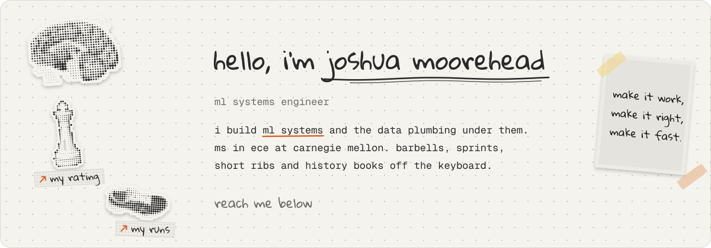

<picture>
  <source media="(prefers-color-scheme: dark)" srcset="banner-dark.svg">
  
</picture>

```text
now      ms in ece at carnegie mellon, building forge
before   data engineering at baron filtration, microscopy research at usc
off      barbells, sprints, short ribs, history books, rapid chess
```

### things i've built

- [**forge**](https://forgelab.up.railway.app): ml experiment tracking with hardware-aware profiling. fastapi, airflow, pytorch.
- [**ladies on the links**](https://ladiesonthelinksgolf.com): a golf league's site, kept up by an issue-to-pr pipeline. cloudflare workers.
- [**distributed system**](https://github.com/C3viche/distributed-system): a fault-tolerant replicated service, with heartbeats and checkpointing.
- [**robot learning**](https://github.com/csce585-mlsystems/SayCan-Extended): ppo, sac and model-based rl, plus llm planning for a robot arm.

### reach me

[portfolio](https://dinq.me/joshuamoorehead) &nbsp; [linkedin](https://www.linkedin.com/in/joshua-moorehead) &nbsp; [email](mailto:josh.moorehead@outlook.com) &nbsp; [my runs](https://www.strava.com/athletes/121070736) &nbsp; [my rating](https://www.chess.com/member/breakfast_enjoyer)
